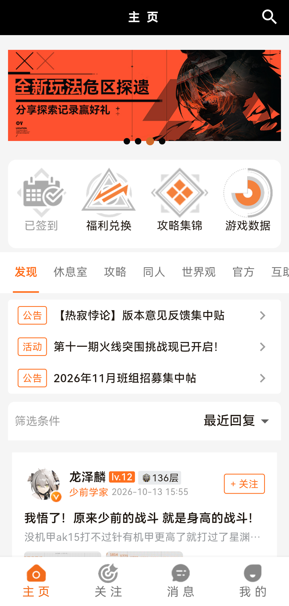
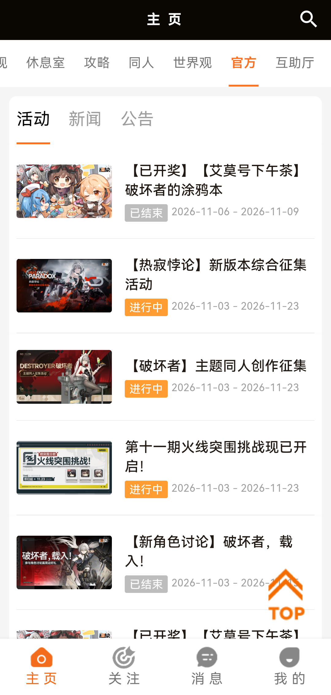
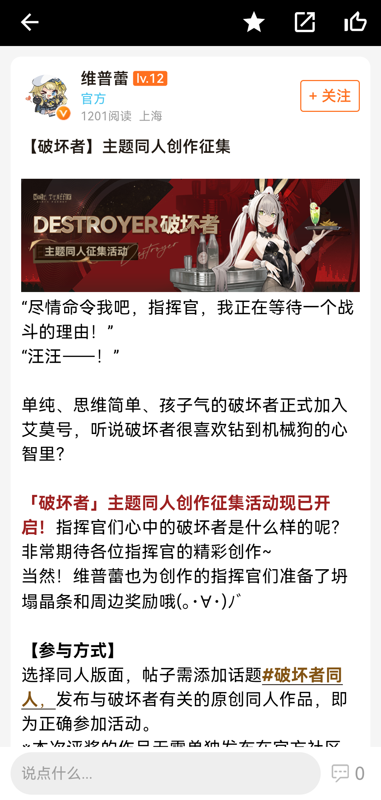
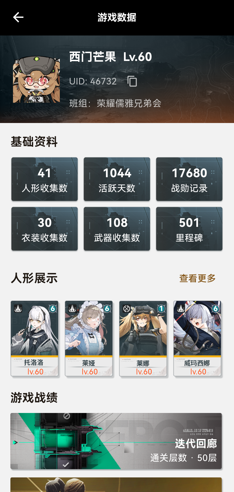
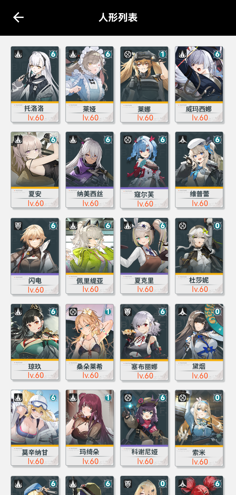
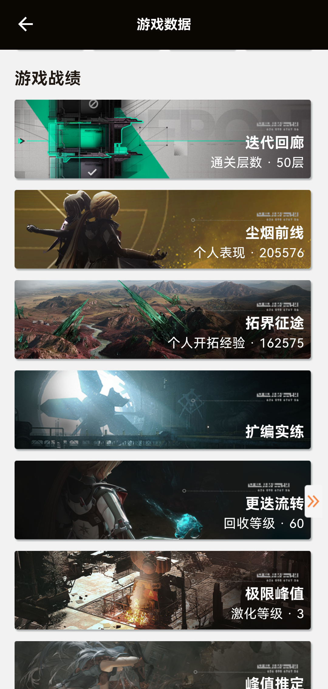
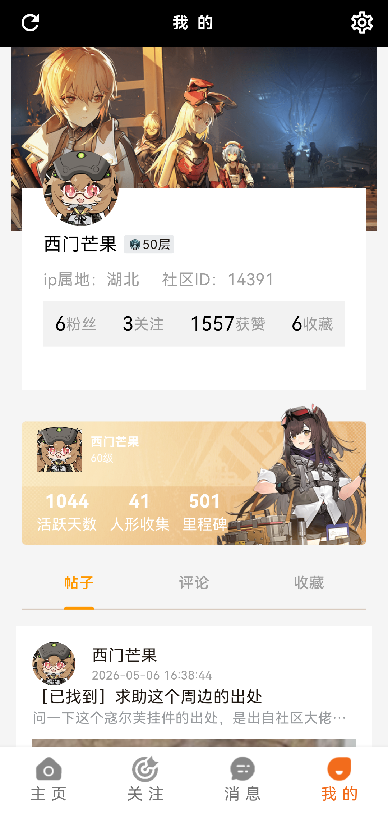
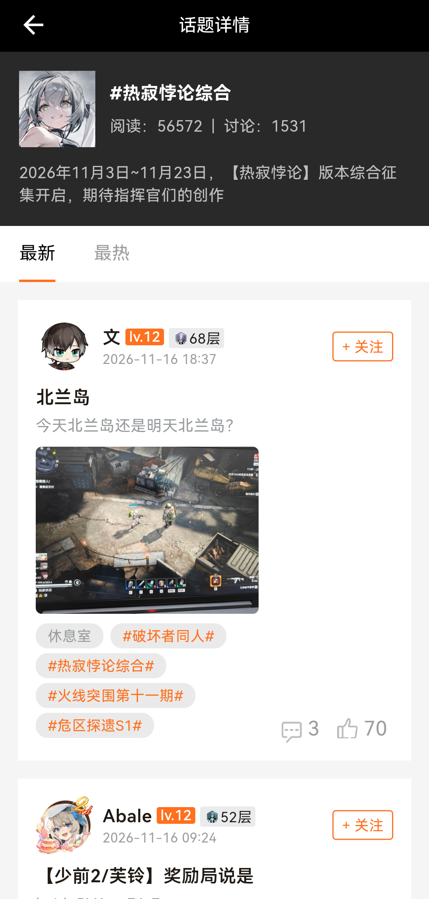
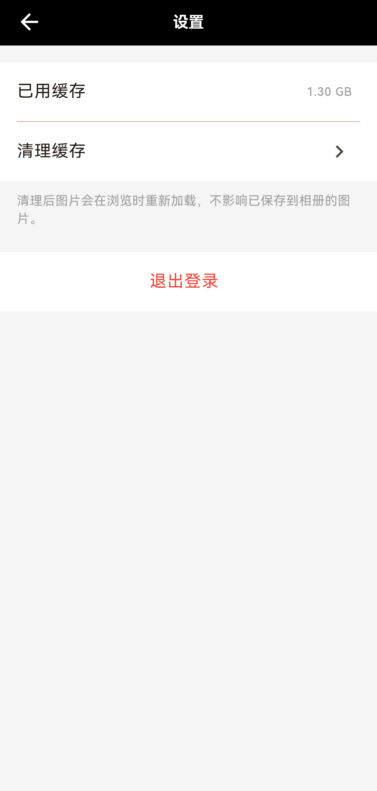

# GRFAnonymous ·《少女前线：追放》社区第三方客户端

> **学习交流与分发渠道声明**
>
> 本 App 的开发旨在学习与交流 Flutter 技术，请遵守相关法律法规及官方社区规则，勿用于违法违规或侵害他人权益的用途。
>
> **开发者仅通过本 GitHub 仓库的 [Releases 页面](https://github.com/Kakuhato/GRFAnonymous/releases) 分发安装包，不提供其他分发渠道，包括但不限于 QQ 群、QQ 文件、各类网盘及第三方下载站。** 请核对仓库地址为 `github.com/Kakuhato/GRFAnonymous`，勿仅凭应用名称、图标或他人转发判断安装包来源。
>
> 非上述渠道获取的安装包，其来源、完整性及是否经过修改均无法由本项目确认，可能存在冒名发布、恶意代码植入等风险。为保护设备与账号安全，请优先从本仓库下载。第三方转载或修改的版本不代表开发者发布或认可；本声明用于说明开发者的分发渠道，不限制开源许可证允许的再分发权利。

GRFAnonymous 是使用 Flutter 开发的《少女前线2：追放》官方社区第三方客户端，提供面向手机的社区浏览、评论互动与游戏数据查看体验。目前提供 Android 安装包。

> **本项目为非官方第三方 App，由开发者独立维护，并非官方发布的客户端，不代表官方立场。**
>
> 游戏及官方社区的内容、规则、活动、奖励与服务均以官方发布为准，相关事项的一切解释权归官方所有。本项目仅提供第三方访问与展示功能，不参与官方运营或活动裁定。

[下载安装](https://github.com/Kakuhato/GRFAnonymous/releases) · [更新记录](CHANGELOG.md) · [问题反馈](https://github.com/Kakuhato/GRFAnonymous/issues) · [官方社区](https://gf2-bbs.exiliumgf.com/)

## 主要功能

| 功能 | 说明 |
| --- | --- |
| 社区浏览 | 分类切换、置顶公告、帖子排序、官方活动 / 新闻 / 公告列表、关注动态 |
| 帖子阅读 | 图文正文、折叠内容、话题标签、大图预览、左右切图与图片保存 |
| 评论互动 | 回复帖子与评论、楼中楼回复面板、点赞、官方表情；当前帖子内临时保留回复草稿 |
| 搜索与跳转 | 搜索帖子和用户，识别帖子 ID 与分享链接；在 App 内打开社区帖子、用户主页和话题详情 |
| 个人与游戏数据 | 个人主页、他人主页、收藏、游戏基础资料、人形展示与游戏战绩 |
| 消息与社区服务 | 查看回复、获赞、关注及通知，提供签到和福利兑换入口 |
| 图片缓存 | 缓存已浏览图片和官方表情，在设置中查看占用并清理；与主动保存到相册的图片分开管理 |

## 下载与使用

前往 [GitHub Releases](https://github.com/Kakuhato/GRFAnonymous/releases) 下载适合设备架构的 Android APK。登录及部分功能依赖官方社区服务，接口调整可能影响客户端功能，请以所安装版本的实际支持情况为准。

使用前请阅读并遵守官方的 [《少女前线2：追放》官方社区用户协议](https://gf2-cn.cdn.sunborngame.com/website/user_agreement/bbs_user_agreement.html) 与 [《少女前线2：追放》官方社区个人信息保护指引](https://gf2-cn.cdn.sunborngame.com/website/user_agreement/bbs_privacy.html)。

## 界面预览

以下均为 Android 真机实际截图，点击图片可查看原图。社区内容与游戏数据随时间变化，界面以实际安装版本为准。

### 社区浏览

<table>
  <tr>
    <th>主页</th>
    <th>官方活动</th>
    <th>帖子详情</th>
  </tr>
  <tr>
    <td></td>
    <td></td>
    <td></td>
  </tr>
</table>

### 游戏数据

<table>
  <tr>
    <th>游戏数据</th>
    <th>人形列表</th>
    <th>游戏战绩</th>
  </tr>
  <tr>
    <td></td>
    <td></td>
    <td></td>
  </tr>
</table>

### 个人主页与话题

<table>
  <tr>
    <th>个人主页</th>
    <th>话题详情</th>
    <th>设置</th>
  </tr>
  <tr>
    <td></td>
    <td></td>
    <td></td>
  </tr>
</table>

## 问题反馈

如遇显示异常或功能问题，欢迎提交 [Issue](https://github.com/Kakuhato/GRFAnonymous/issues)。请附上 App 版本、设备与系统版本、复现步骤，以及必要的截图或日志；提交前请移除密码、登录令牌（Authorization）、验证码等敏感信息。

## 开源许可与内容归属

项目代码采用 [GNU GPL v3.0](LICENSE) 开源许可证，使用、修改和分发代码请遵守该许可证。

《少女前线2：追放》的名称、标识、角色、官方图片及其他游戏素材的相关权利归官方及相应权利人所有，社区用户发布的作品归相应作者或权利人所有。本项目的代码许可证不代表对上述内容的再授权。截图仅用于展示客户端功能。

